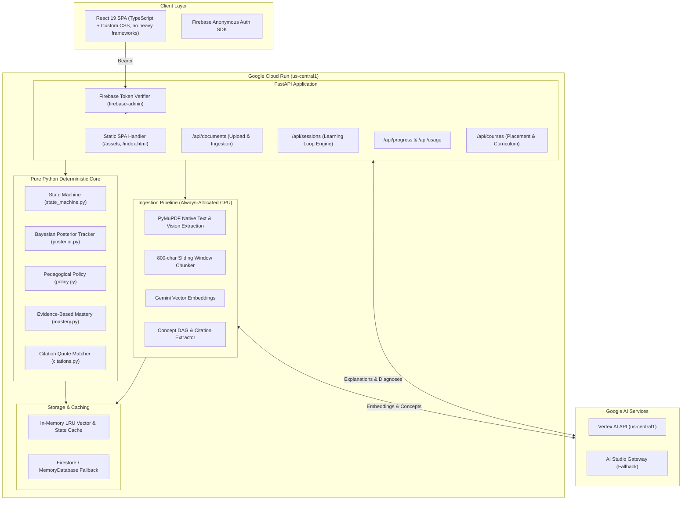

# UNSTUCK — Technical Architecture & Implementation Spec

**Status**: Production Live · **Updated**: October 2026 · **Host**: Google Cloud Run (`us-central1`) · **Project ID**: `unstuck-e6012`  
**Live URL**: [https://unstuck-api-783684471532.us-central1.run.app](https://unstuck-api-783684471532.us-central1.run.app)  
**AI Mode**: Dual-Mode (Primary: Vertex AI via ADC · Fallback: Google AI Studio via API key)

This file is the **source of truth** for human developers and AI coding agents. If the codebase and this document ever diverge, reconcile them immediately.

---

## 0. Non-Negotiable Engineering Rules

1. **Contract first.** Do not modify an API shape, Pydantic schema, or database field without updating sections 6–7.
2. **The backend owns the learning loop.** Gemini generates and interprets content. It never decides the next state and never writes mastery.
3. **Never send the answer key or misconception signals to the client** before the student submits their response.
4. **No secrets in git or frontend.** The Firebase service account, GCP project keys, and Gemini keys live strictly in environment variables.
5. **No fake or canned AI responses.** All LLM failures return clear, retryable errors (HTTP 503 `model_unavailable`). Grounded labels (`grounded=True`) are only applied when citations are verified against real chunk text. The fractions sample path uses hand-verified, pre-authored content clearly marked as sample data.
6. **Every LLM call goes through `BaseLLM`** (`LLMClient` with rate limiting, timeouts, and structured schema retry). No direct SDK calls from routers.
7. **Zero dev/mock auth paths in production.** Authentication requires valid Firebase ID tokens issued via Firebase Anonymous Auth.
8. **Pure cognitive core.** State machine (`state_machine.py`), Bayesian posterior (`posterior.py`), policy (`policy.py`), and mastery logic (`mastery.py`) are pure Python without I/O and have 100% unit test coverage.
9. **Strict CORS allowlist.** Allowed origins are explicitly restricted to local dev (`http://localhost:5173`, `http://localhost:3000`), the Cloud Run production origin, and Firebase hosting domains. No wildcard `*` CORS.

---

## 1. Hosting & Infrastructure Decisions

### 1.1 Deployment Topology
- **Unified Single Container on Google Cloud Run**: The backend FastAPI service packages the built React 19 frontend into `backend/static` and serves it directly. This removes cross-origin latency, eliminates CORS friction on the primary domain, and avoids multiple service cold starts.
- **Region**: `us-central1` (colocated with Vertex AI models).
- **Resources**: 1 vCPU, 512 MiB RAM, `min-instances=1`, `max-instances=2`.
- **CPU Allocation**: `--cpu-always-allocated` is enabled. This ensures FastAPI `BackgroundTasks` (such as PDF chunking, embedding, and concept extraction) execute continuously without throttling or instance termination after the 202 response is returned.

### 1.2 Dual-Mode Generative AI
- **Primary**: **Google Cloud Vertex AI** (`LLM_BACKEND=vertex`) using the unified `google-genai` SDK and Cloud Run Workload Identity / Application Default Credentials (ADC).
- **Fallback**: **Google AI Studio** (`LLM_BACKEND=aistudio`) using `GEMINI_API_KEY`. If trial credits deplete, switching to AI Studio maintains service availability without code changes.
- **Models**:
  - `gemini-2.5-flash-lite`: Used for fast structured extraction, blind-solve verification, and option interpretation.
  - `gemini-2.5-flash` / `gemini-1.5-flash`: Used for curriculum analysis and grounded explanation generation.
  - `gemini-embedding-001`: Vector embeddings for retrieval grounding.

### 1.3 Billing & Credit Management
- The Google Cloud trial provides $300 in credits valid for 90 days.
- **Budget Alerts**: Configured in Google Cloud Console (`Billing → Budgets`) at **$50** and **$150** to prevent unexpected overages.
- At 1 vCPU with `min-instances=1` and `--cpu-always-allocated`, the continuous baseline cost is ~$4–$6/month, well within the $300 credit allocation.

---

## 2. System Architecture



---

## 3. The Cognitive Learning Loop

The platform replaces generic chatbot conversation with a **finite state machine** that diagnoses misconceptions before providing tailored instruction.

### 3.1 State Transitions

```
[START]
   │
   ▼
[PROBE] ──────── Student submits answer ────────► [EVALUATE]
                                                      │
         ┌────────────────────────────────────────────┴─────────────────────────────┐
         ▼                                                                          ▼
   Answer Correct                                                             Answer Incorrect
         │                                                                          │
         ▼                                                       ┌──────────────────┴──────────────────┐
 [TRANSFER-CHECK]                                                ▼                                     ▼
   (different context)                                  Hypothesis Supported                 Hypothesis Ambiguous
         │                                                (p ≥ 0.60, Δ ≥ 0.25)                         │
         ├──────────────┐                                        │                                     ▼
         ▼              ▼                                        │                               [FOLLOW-UP]
     Success         Failure                                     │                           (max 2 questions)
         │              │                                        │                                     │
         ▼              ▼                                        ▼                                     ▼
     [SUMMARY]     [EXPLAIN] ◄───────────────────────────────────┴─────────────────────────────────────┘
                        │
                        ▼
                    [PRACTICE] ─── Fresh question in same context
                        │
                        ├──────────────────────────┐
                        ▼                          ▼
                     Correct                    Incorrect
                        │                          │
                        ▼                          ▼
                 Mastery verified?           Retry different strategy
                 (2 clean transfers)         (max 3 cycles)
                   │          │                    │
                  Yes         No                   ▼
                   │          │              [PREREQ-REVIEW]
                   ▼          ▼                    │
              [SUMMARY]   [PRACTICE]               ▼
                                               [SUMMARY]
```

### 3.2 Bayesian Posterior Tracking (`posterior.py`)
Hypotheses: $H = \{M_1, M_2, \dots, M_k, \text{NONE}\}$.
- **Prior**: Uniform over $M_i$, with $\text{NONE} = 0.20$, normalized.
- **Correct answer update**: Likelihood for $M_i = 0.20$, $\text{NONE} = 0.90$.
- **Distractor chosen ($o$)**: Likelihood for $M_i = o.\text{signals}.get(M_i, 0.05)$, $\text{NONE} = 0.10$.
- **Justification reading**: LLM classifies free text into `supports` ($\times 3.0$), `contradicts` ($\times 0.25$), or `unclear` ($\times 1.0$).
- **Student Challenge ("That's not why I chose it")**: Multiplies challenged hypothesis by $0.20$ and renormalizes.
- **Decision Rule**: Hypothesis accepted when $P(M^*) \ge 0.60$ and $P(M^*) - P(M_{\text{second}}) \ge 0.25$. Otherwise, follow-up probe is issued.

### 3.3 Pedagogical Policy (`policy.py`)
Remediation strategies: `hint`, `simplified`, `worked_example`, `analogy_visual`, `prerequisite_review`.
1. Select the concept's preferred strategy that has not yet been attempted.
2. If remediation fails on the subsequent practice question, that strategy is retired for the session.
3. After two failed strategies, trigger `prerequisite_review`.
4. For tentative hypotheses, prioritize lower-commitment strategies (`hint` or `simplified`).

### 3.4 Evidence-Based Mastery (`mastery.py`)
Mastery is derived mathematically from student attempt history—never hallucinated by an LLM:
- **`not_assessed`**: 0 scored attempts.
- **`developing`**: At least 1 scored attempt.
- **`demonstrated`**: The last **2 scored attempts are correct**, on **distinct questions** with **different context tags**, **without hints**, and at least one attempt occurred after remediation (or two clean transfer successes).
- Any subsequent incorrect scored attempt immediately demotes status back to `developing`.

---

## 4. Question Quality & Verification

Every dynamically generated question must pass automated validation before being stored:
1. **Schema Validation**: 3–4 options, exactly one correct option, each distractor maps to $\ge 1$ known misconception, valid context tag.
2. **Blind Solve**: A secondary LLM call evaluates only the stem and options (without the answer key). If the solver disagrees with the key, the question is rejected and regenerated.
3. **Similarity Filter**: Stem cosine similarity against previously used questions in the session must be $< 0.90$.
4. **Source Grounding**: Referenced source chunks must exist in the document's stored index.
5. Questions failing validation are discarded; unverified questions are never presented to students.

---

## 5. Ingestion & Retrieval Pipeline

```
[Upload PDF/PNG or Paste Text]
             │
             ▼
     Input Validation (type, size, min-length: 80 chars)
             │
             ▼
   Quota Check (daily upload allowance)
             │
             ▼
      [Status: queued] (HTTP 202 Accepted returned to client)
             │
             ▼ (FastAPI BackgroundTask on Always-Allocated CPU)
    [Status: extracting] ── PyMuPDF extracts text per page
             │
             ▼
    [Status: vision] ──── Scanned/image pages transcribed via Gemini Multimodal
             │
             ▼
   [Status: chunking] ─── Sliding window (~800 chars, 100 overlap)
             │
             ▼
  [Status: embedding] ─── gemini-embedding-001 vector storage
             │
             ▼
[Status: concepts_ready] Concept DAG extracted with source quotes
             │
             ▼
     [Status: ready] ─── Document ready for study sessions
```

### 5.1 Citation Verification
- Gemini explanations return candidate citations: `[{chunk_id, quote}]`.
- The backend matches `normalize(quote)` against the actual text of `chunk_id`.
- Mismatched or hallucinated quotes are stripped.
- If no citations pass verification, the response is explicitly tagged: `"General explanation, not found in your material"`.

---

## 6. Authentication & Security

- **Authentication**: Firebase Anonymous Authentication. When a student visits the application, an anonymous Firebase session is created and refreshed in the browser.
- **Backend Verification**: Every request to `/api/*` requires an `Authorization: Bearer <Firebase_ID_Token>` header.
- The server validates tokens using `firebase-admin.auth.verify_id_token`.
- Mock tokens (`dev-*`) are strictly rejected with HTTP 401.
- In test environments, authentication is mocked cleanly via FastAPI `dependency_overrides[current_user]` without introducing bypass branches in production code.

---

## 7. API Specification

| Endpoint | Method | Status | Description |
|---|---|---|---|
| `/health` | GET | 200 | Health probe and service version (public) |
| `/api/documents` | POST | 202 | Upload PDF/PNG/JPG or JSON `{title, text}` |
| `/api/documents/sample` | POST | 200 | Clones curated Fractions study notes |
| `/api/documents/{id}` | GET | 200 | Poll ingestion progress and view concept DAG |
| `/api/documents/{id}` | DELETE | 200 | Delete document and associated vectors/concepts |
| `/api/sessions` | POST | 200 | Initialize study session for concept `{documentId, conceptId}` |
| `/api/sessions/{id}` | GET | 200 | Fetch current step (refresh-safe) |
| `/api/sessions/{id}/answer` | POST | 200 | Submit multiple-choice option or justification |
| `/api/sessions/{id}/challenge` | POST | 200 | Challenge hypothesis ("That's not why I chose it") |
| `/api/sessions/{id}/summary` | GET | 200 | Session report with before/after status and strategies |
| `/api/progress` | GET | 200 | Student concept mastery and diagnostic history |
| `/api/usage` | GET | 200 | Daily upload and LLM usage quota remaining |
| `/api/courses` | POST | 200 | Create topic-based course ("Learn with AI") |
| `/api/courses/{id}` | GET | 200 | View course syllabus and placement results |

---

## 8. Verification & Test Suite

The test suite consists of **100 pure unit and integration tests** covering the entire stack:
- **`test_state_machine.py`**: State machine transitions under all outcome paths.
- **`test_posterior.py`**: Bayesian probability updates, normalization, and challenge penalties.
- **`test_policy.py`**: Strategy selection, fallback order, and cycle exhaustion.
- **`test_mastery.py`**: Attempt scoring, transfer verification, and demotion triggers.
- **`test_flow.py`**: End-to-end learning loop, two-student signature demo, student challenge flow.
- **`test_documents_api.py`**: Upload validation, quota enforcement, scanned image handling, and deletion.
- **`test_extract.py`**: PDF parsing, image sniffing, and text normalization.
- **`test_llm.py`**: Rate limiting, retry on schema violation, and provider error isolation.
- **`test_vectors.py`**: In-memory cosine search, float16 packing, and storage limits.

To run the complete test suite:
```bash
python -m pytest backend/tests/ -v
```
All 100 tests pass unconditionally without network access or active API keys.
